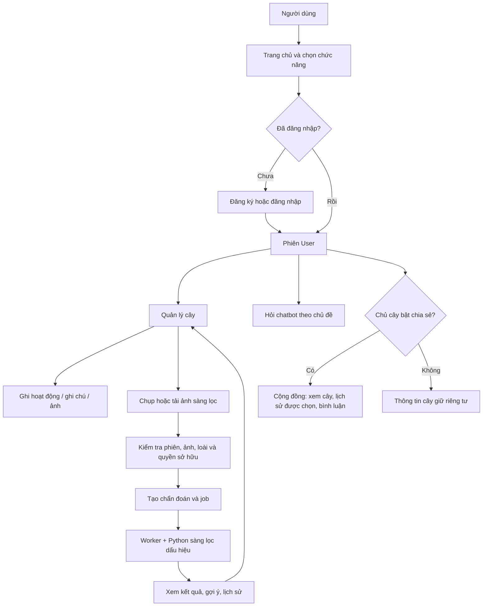
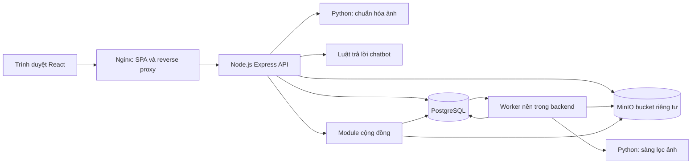
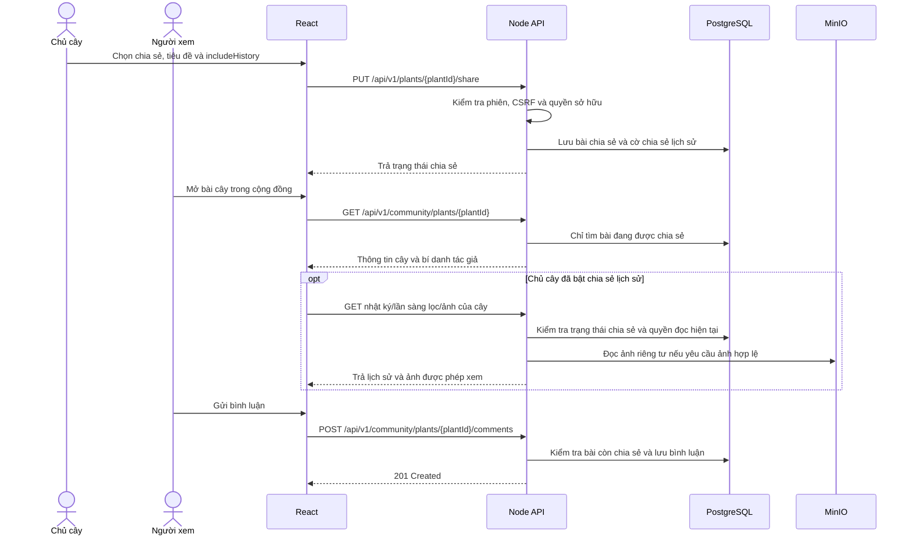

# Tóm tắt và phân tích hệ thống PlantCare AI

## 1. Tổng quan dự án

PlantCare AI là ứng dụng web tiếng Việt, ưu tiên sử dụng trên điện thoại, hỗ trợ người trồng cây tại nhà theo dõi cây, ghi nhật ký chăm sóc, quan sát dấu hiệu trên lá qua ảnh và trao đổi trong cộng đồng. Mục tiêu nghiệp vụ là tập hợp thông tin của từng cây và lịch sử chăm sóc vào một nơi để người trồng dễ theo dõi, thay vì đưa ra kết luận chẩn đoán thay cho chuyên gia.

**Trạng thái đối chiếu mã nguồn: bản local 0.4.** Hệ thống hỗ trợ năm loài: cà chua, dưa leo, ớt, húng quế và bạc hà. Các chức năng đang chạy, giới hạn hiện tại và định hướng chưa triển khai được phân biệt trong tài liệu này.

## 2. Tác nhân và phạm vi nghiệp vụ

| Tác nhân | Nghiệp vụ |
| --- | --- |
| Khách chưa đăng nhập | Xem giao diện giới thiệu. Các API cây, nhật ký, sàng lọc, chatbot và cộng đồng yêu cầu phiên đăng nhập. |
| User | Đăng ký/đăng nhập; quản lý hồ sơ và cây của mình; ghi hoạt động và ghi chú có ảnh; sàng lọc ảnh; xem, thử lại hoặc xóa lần sàng lọc của mình; hỏi chatbot; tự chọn chia sẻ cây/lịch sử và bình luận. |
| Admin | Vai trò `admin` có trong thiết kế tài khoản, nhưng API quản trị danh mục, duyệt hướng dẫn và số liệu vận hành chưa được triển khai ở bản local 0.4. Không nên xem các nghiệp vụ quản trị trong tài liệu mục tiêu là chức năng hiện có. |

### Giá trị và giới hạn kết quả sàng lọc

Luồng ảnh hiện dùng `visual-screening-1`, một bộ **sàng lọc dấu hiệu thị giác**, không phải mô hình đã được huấn luyện để nhận diện bệnh. Python kiểm tra ảnh và tìm vùng ngả vàng/chấm sẫm; kết quả nghiệp vụ là:

- `healthy`: chưa thấy hai dấu hiệu này đủ rõ trong vùng lá quan sát.
- `uncertain`: ảnh chưa đủ chất lượng hoặc chưa đủ căn cứ thị giác.
- Khi có dấu hiệu: trả danh sách phát hiện, nguyên nhân có thể và bước quan sát/chăm sóc gợi ý theo loài.

Kết quả không khẳng định cây mắc bệnh. Chatbot cũng chưa gọi mô hình ngôn ngữ: API chọn câu trả lời theo từ khóa, loài cây và nội dung chăm sóc biên soạn sẵn, kèm nguồn tham khảo khi phù hợp. Mô hình phân loại bệnh đã kiểm định và API quản trị là phần định hướng tiếp theo.

## 3. Nghiệp vụ chính và quy tắc

### 3.1 Tài khoản và quyền truy cập

1. Người dùng đăng ký bằng email và mật khẩu; nếu cung cấp số điện thoại thì lưu vào hồ sơ. Đăng ký công khai luôn tạo quyền `user`.
2. Khi đăng nhập thành công, hệ thống cấp cookie phiên; trình duyệt dùng CSRF token cho thao tác ghi.
3. API lấy ID chủ sở hữu từ phiên, không tin ID tài khoản do client gửi. Cây, nhật ký, ảnh và lần sàng lọc riêng chỉ được đọc/ghi bởi chủ sở hữu.
4. Đăng xuất thu hồi phiên. Đổi email hoặc mật khẩu yêu cầu mật khẩu hiện tại và thu hồi các phiên đang có.

### 3.2 Theo dõi cây và nhật ký

- User tạo cây bằng loài đang được hỗ trợ, biệt danh và thông tin tùy chọn như ngày trồng/ghi chú.
- Loài được cố định sau khi tạo. User có thể cập nhật thông tin hoặc lưu trữ/khôi phục cây; lưu trữ không xóa nhật ký và lịch sử sàng lọc.
- User ghi hoạt động `watering`, `fertilizing` hoặc `observation`; ghi chú nhật ký có thể có nội dung, tối đa bốn ảnh, hoặc cả hai.
- Nhật ký và danh sách cây được phân trang. Ghi hoạt động mới chỉ áp dụng cho cây đang theo dõi; ghi chú có thể bổ sung cho cây đã lưu trữ.

### 3.3 Sàng lọc ảnh

1. User chọn/chụp ảnh, chọn loài và tùy chọn gắn với một cây của mình. Loài của cây phải khớp loài gửi lên.
2. API kiểm tra phiên, CSRF, định dạng/kích thước ảnh, giới hạn hàng đợi và khóa chống gửi trùng.
3. Ảnh được chuẩn hóa thành JPEG và bỏ metadata EXIF; ảnh lưu trong bucket riêng tư MinIO (local), còn PostgreSQL lưu metadata, trạng thái và job.
4. API nhận yêu cầu bất đồng bộ và trả `202 Accepted` cùng ID chẩn đoán. Worker trong backend nhận job, đọc ảnh từ MinIO rồi gọi dịch vụ Python.
5. Backend lưu trạng thái/kết quả sàng lọc. Gợi ý chăm sóc được ghép theo loài và các dấu hiệu đã lưu khi API trả kết quả.
6. Giao diện hỏi trạng thái đến khi hoàn tất hoặc lỗi. User có thể xem lịch sử, thử lại một số lỗi dịch vụ tạm thời hoặc xóa lần sàng lọc của mình.

Quy tắc đáng chú ý: mỗi ảnh dùng cho tối đa một chẩn đoán; khóa idempotency thuộc phạm vi tài khoản; cùng khóa và cùng nội dung trả lại lần sàng lọc cũ, cùng khóa nhưng nội dung khác trả `409`. Bản local giới hạn tối đa 3 job đang chờ/chạy trên một tài khoản, 30 job toàn hệ thống; worker tự thử tối đa 3 lượt cho lỗi dịch vụ tạm thời.

### 3.4 Chia sẻ cộng đồng

- Chủ cây chủ động bật chia sẻ, đặt tiêu đề/nội dung giới thiệu và chọn có chia sẻ lịch sử hay không. Có thể tắt chia sẻ; khi tắt, quyền chia sẻ lịch sử cũng bị tắt.
- Người dùng đã đăng nhập xem cây đang được chia sẻ, bình luận và đọc nhật ký/lần sàng lọc chỉ khi chủ cây đã bật chia sẻ lịch sử.
- Tên tác giả được thay bằng bí danh cộng đồng. Backend kiểm tra lại quyền chia sẻ trước khi trả dữ liệu/ảnh, không dựa vào việc giao diện đã ẩn liên kết.
- Tác giả bình luận hoặc chủ cây có thể xóa bình luận.

### 3.5 Chatbot chăm cây

User gửi câu hỏi (tối đa 600 ký tự), có thể chọn loài. Backend chuẩn hóa tiếng Việt, nhận diện chủ đề/từ khóa và trả hướng dẫn cùng liên kết tham khảo phù hợp. Khi thiếu thông tin, chatbot hỏi thêm về loài hoặc dấu hiệu; một số câu trả lời đề nghị chụp ảnh để mở luồng sàng lọc. Đây là hội thoại theo luật định sẵn, không phải hội thoại LLM.

## 4. Luồng nghiệp vụ tổng quát



### Luồng 1 — Theo dõi và chăm sóc cây

1. User đăng nhập, mở **Cây của tôi**, chọn loài và tạo hồ sơ cây.
2. User ghi mốc tưới/bón/quan sát hoặc tạo ghi chú, có thể đính kèm ảnh.
3. Khi cây ngừng theo dõi, User lưu trữ thay vì xóa; lịch sử vẫn có thể xem lại.
4. Từ hồ sơ cây, User mở lịch sử sàng lọc đã gắn với cây hoặc bắt đầu lần sàng lọc mới.

### Luồng 2 — Sàng lọc ảnh

1. User chụp/chọn ảnh, xem trước, chọn loài và tùy chọn cây; client giữ `Idempotency-Key` để gửi lại an toàn khi mạng lỗi.
2. Backend xác thực phiên/CSRF, kiểm tra đầu vào, quyền sở hữu cây, giới hạn tải và khóa trùng.
3. Python chuẩn hóa ảnh; backend lưu ảnh riêng tư và ghi chẩn đoán/job. Nếu dữ liệu đã được gửi trước đó với cùng khóa, backend trả lại ID cũ.
4. Worker xử lý job qua các trạng thái `queued` → `processing` → `completed` hoặc `failed`, sử dụng lease để tránh hai worker cùng hoàn tất một job.
5. React gọi API đọc trạng thái theo ID. Khi hoàn tất, giao diện hiển thị dấu hiệu, hướng dẫn và nguồn; khi chưa chắc chắn, hướng dẫn chụp lại/quan sát thêm thay vì kết luận bệnh.
6. User có thể thử lại lỗi dịch vụ được phép hoặc xóa kết quả. Xóa kết quả làm ảnh chuyển sang hàng chờ dọn và giữ khóa idempotency đã xóa trong 24 giờ.

### Luồng 3 — Chia sẻ cây

1. Chủ cây mở cài đặt chia sẻ, nhập nội dung và chọn `includeHistory`.
2. Backend lưu trạng thái chia sẻ dưới hồ sơ cây. Nếu tắt chia sẻ, bài và quyền xem lịch sử bị tắt.
3. Người dùng khác đăng nhập để xem bài. Nếu lịch sử được bật, API mới trả các nhật ký/lần sàng lọc và ảnh tương ứng; nếu không, chỉ trả thông tin bài cây.
4. Người xem có thể bình luận. Chủ cây hoặc tác giả bình luận có thể xóa bình luận theo quy tắc quyền.

## 5. Kiến trúc hệ thống hiện tại

### Thành phần

| Thành phần | Công nghệ | Trách nhiệm |
| --- | --- | --- |
| Giao diện | React 19, TypeScript, Vite | Trang chủ, vườn cây, camera/ảnh, nhật ký, sàng lọc, chatbot, cộng đồng, cài đặt. |
| Web server | Nginx | Phục vụ SPA và chuyển tiếp API cùng origin đến backend. |
| Backend | Node.js 22+, Express 5, TypeScript | Modular Monolith: xác thực, hồ sơ, cây, nhật ký, cộng đồng, media, chẩn đoán và chatbot; REST API/OpenAPI. |
| Worker | Tiến trình nền được khởi chạy bên trong backend local | Nhận job từ PostgreSQL, điều phối ảnh qua MinIO/Python, cập nhật trạng thái và dọn ảnh chờ xóa. Không phải container worker riêng trong Compose hiện tại. |
| Cơ sở dữ liệu | PostgreSQL 16 | Tài khoản/phiên, cây, nhật ký, chẩn đoán, job, cộng đồng và metadata ảnh. Migration chạy trước backend. |
| Lưu ảnh | MinIO, tương thích S3 | Bucket riêng tư lưu JPEG đã chuẩn hóa; không lưu ảnh nhúng trực tiếp trong hàng nghiệp vụ. Production dự kiến dùng Cloudflare R2. |
| Dịch vụ ảnh | Python, Pillow, NumPy | Kiểm tra/chuẩn hóa ảnh và sàng lọc dấu hiệu thị giác. Chỉ truy cập qua mạng nội bộ. |

### Sơ đồ thành phần và dữ liệu



Trong Docker Compose, frontend mở tại `localhost:8080`; API, PostgreSQL, MinIO và Python được chia mạng nội bộ phù hợp. Dữ liệu PostgreSQL và MinIO nằm trong Docker volumes. Sơ đồ triển khai và hợp đồng API chi tiết ở [kiến trúc](../03-kien-truc/README.md), [API](../03-kien-truc/api.md) và [ERD/ràng buộc dữ liệu](../04-du-lieu/README.md).

## 6. Sequence diagram

### 6.1 Sàng lọc ảnh — luồng bất đồng bộ đang triển khai

```mermaid
sequenceDiagram
    actor U as User
    participant W as React
    participant N as Nginx
    participant A as Node API
    participant P as Python
    participant S as MinIO
    participant D as PostgreSQL
    participant Q as Worker trong backend

    U->>W: Chọn ảnh, loài, cây tùy chọn
    W->>N: POST /api/v1/diagnoses (multipart, cookie, CSRF, Idempotency-Key)
    N->>A: Chuyển tiếp yêu cầu cùng origin
    A->>A: Xác thực phiên, CSRF, định dạng và giới hạn tải
    A->>D: Kiểm tra khóa idempotency, loài, quyền sở hữu cây và sức chứa
    alt Khóa đã dùng cho cùng nội dung
        A-->>W: 200 + ID/trạng thái của lần sàng lọc cũ
    else Khóa đã dùng cho nội dung khác hoặc đã bị xóa
        A-->>W: 409 conflict hoặc 410 gone
    else Yêu cầu mới hợp lệ
        A->>P: POST /prepare (ảnh gốc)
        P-->>A: JPEG đã chuẩn hóa, bỏ metadata
        A->>S: Lưu ảnh riêng tư
        A->>D: Ghi metadata ảnh, diagnosis và job trong giao dịch
        A-->>W: 202 Accepted + diagnosisId
        W-->>U: Hiển thị trạng thái đang chờ
        par Worker xử lý độc lập với HTTP request
            loop Worker nhận job đến khi chẩn đoán kết thúc
                Q->>D: Nhận job đủ điều kiện, tạo lease, chuyển processing
                Q->>S: Đọc ảnh theo object key nội bộ
                Q->>P: POST /analyze
                alt Python trả kết quả hợp lệ
                    P-->>Q: outcome, findings, quality, modelVersion
                    Q->>D: Lưu kết quả và completed
                else Lỗi dịch vụ tạm thời
                    P-->>Q: Lỗi hoặc timeout
                    Q->>D: Đặt queued để thử lại; hết lượt thì chuyển failed
                end
            end
        and React theo dõi trạng thái
            loop Khi status là queued hoặc processing
                W->>N: GET /api/v1/diagnoses/{id}
                N->>A: Chuyển tiếp yêu cầu
                A->>D: Đọc trạng thái theo chủ sở hữu
                A-->>W: Trạng thái/kết quả và gợi ý theo loài
            end
        end
        W-->>U: Hiển thị dấu hiệu, bước chăm sóc và nguồn tham khảo
    end
    Note over U,W: Nếu job kết thúc failed do dịch vụ sàng lọc, chủ sở hữu có thể yêu cầu retry khi đủ điều kiện
```

### 6.2 Tạo ghi chú chăm sóc kèm ảnh

```mermaid
sequenceDiagram
    actor U as User
    participant W as React
    participant A as Node API
    participant P as Python
    participant S as MinIO
    participant D as PostgreSQL

    U->>W: Nhập ghi chú/ngày giờ, chọn tối đa 4 ảnh
    W->>A: POST /api/v1/plants/{plantId}/notes (JSON hoặc multipart)
    A->>A: Kiểm tra phiên, CSRF, ảnh và giới hạn tải
    A->>D: Kiểm tra cây thuộc tài khoản
    loop Mỗi ảnh được gửi
        A->>P: Chuẩn hóa JPEG và bỏ EXIF
        P-->>A: Ảnh đã chuẩn hóa
        A->>S: Ghi ảnh vào bucket riêng tư
    end
    A->>D: BEGIN; kiểm tra lại chủ cây; ghi note và liên kết ảnh; COMMIT
    A-->>W: 201 Created + ghi chú/đường dẫn ảnh riêng tư
    W-->>U: Hiển thị ghi chú trong dòng thời gian cây
```

### 6.3 Chia sẻ cây và đọc lịch sử cộng đồng



## 7. Dữ liệu và ranh giới tin cậy

- PostgreSQL lưu dữ liệu cấu trúc; các ràng buộc khóa ngoại ghép bảo đảm ảnh/cây gắn đúng chủ và lần sàng lọc gắn đúng loài.
- Object key ảnh là ngẫu nhiên/nội bộ, bucket không public. API chỉ đọc ảnh sau khi kiểm tra chủ sở hữu hoặc trạng thái chia sẻ hiện hành.
- Mật khẩu băm Argon2id; database lưu bản băm token phiên, không lưu token cookie thuần. API kiểm tra `Origin` và CSRF cho thao tác thay đổi dữ liệu.
- Ảnh được giải mã, kiểm tra định dạng/kích thước, xoay theo EXIF rồi mã hóa lại; metadata EXIF không được giữ trong ảnh chuẩn hóa.
- Chi tiết vòng đời/xóa ảnh và schema ở [vòng đời dữ liệu](../04-du-lieu/vong-doi-du-lieu.md) và [ràng buộc SQL](../04-du-lieu/rang-buoc.md).

## 8. Giới hạn và hướng phát triển

1. Thay bộ sàng lọc màu bằng mô hình nhận diện bệnh đã có dữ liệu gán nhãn, đánh giá độc lập và ngưỡng trả `uncertain`.
2. Xây API/quy trình Admin để quản lý danh mục và biên soạn, duyệt, xuất bản hướng dẫn có phiên bản.
3. Đưa worker thành tiến trình/container riêng nếu tải nền yêu cầu mở rộng độc lập; hiện tại worker chạy trong backend.
4. Kiểm thử camera trên thiết bị thật, ảnh thực địa, tải và phục hồi; triển khai production với HTTPS và R2 theo tài liệu triển khai.

Chi tiết tiến độ và các quyết định đã chốt được ghi tại [trạng thái bàn giao](../02-phat-trien/trang-thai.md), [nhật ký quyết định](../02-phat-trien/quyet-dinh.md) và [kế hoạch kiểm thử](../06-kiem-thu/README.md).
