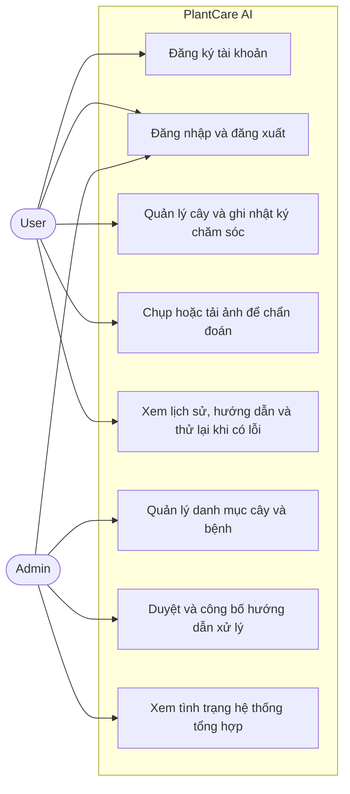
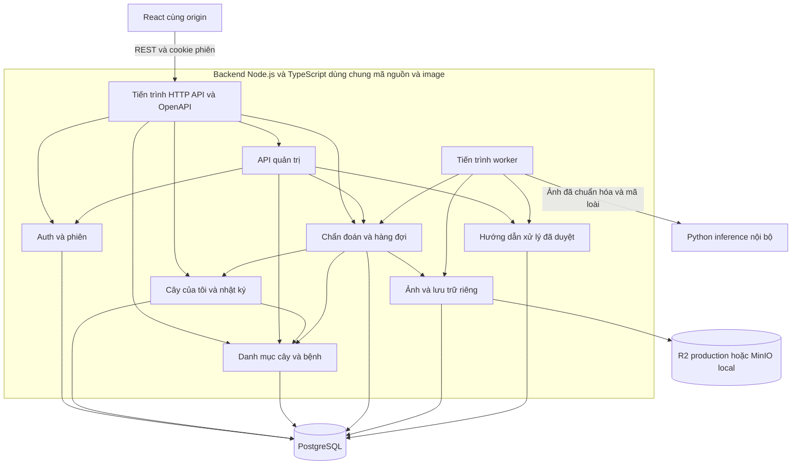
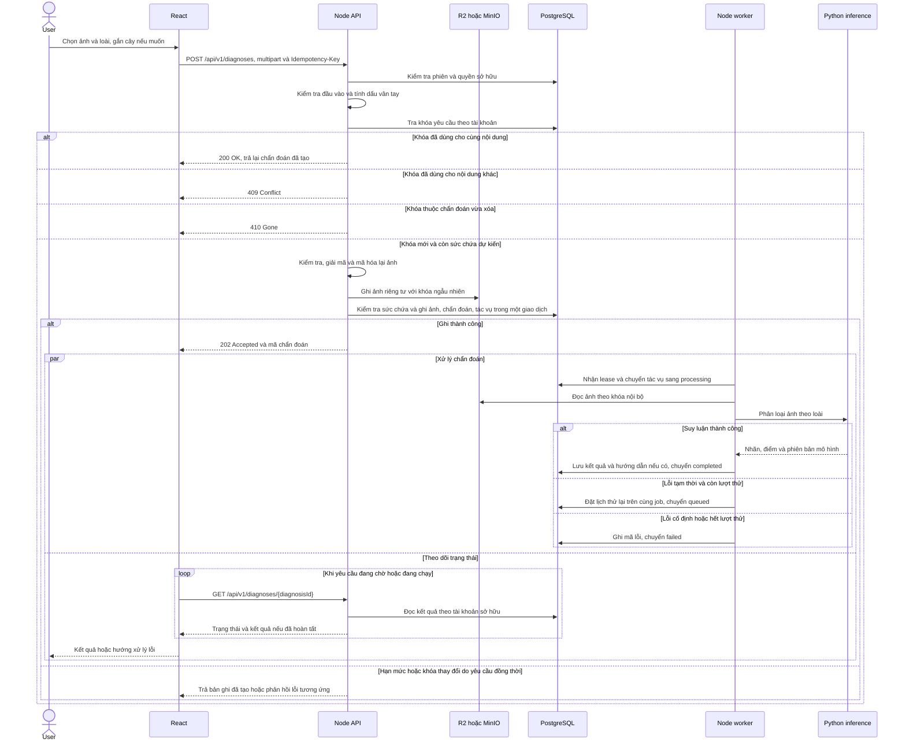

# Kiến trúc PlantCare AI

[API và Swagger](api.md) · [Mô hình dữ liệu](../04-du-lieu/README.md) · [Triển khai và vận hành](trien-khai.md)

[Ảnh sơ đồ hệ thống, ERD, use case và sequence](../07-so-do/README.md) · [Tích hợp AI theo mã hiện tại](tich-hop-ai.md)

## Mã nguồn bản 0.5

| Phần | Trách nhiệm |
| --- | --- |
| `frontend/src` | React điều hướng và hiển thị Trang chủ, hồ sơ cây, nhật ký ảnh, cộng đồng, chatbot và cài đặt tài khoản. Camera và kiểm tra tệp ảnh dùng chung giữa các màn hình liên quan. |
| `backend/src/modules/plants` và `journal` | Hồ sơ theo chủ tài khoản. Nhật ký lưu hoạt động, ghi chú, ngày giờ và đính kèm ảnh tùy chọn, kể cả trên cây đã lưu trữ. |
| `backend/src/modules/media` | Chuẩn hóa ảnh qua Python, ghi MinIO và quản lý vòng đời ảnh. Quét, nhật ký và ảnh đại diện dùng chung giới hạn một lượt tải đồng thời mỗi tài khoản và hai lượt cả tiến trình. |
| `backend/src/modules/community` | Nhiều bài trên một cây, ảnh, cảm xúc, bình luận ảnh/trả lời/thích và lịch sử chủ động chia sẻ. Quyền tổng/lịch sử kiểm tra lại trước và sau khi lấy ảnh. [Hợp đồng](cong-dong.md) |
| `backend/src/modules/profile` | Hồ sơ chính chủ và đổi thông tin đăng nhập, với phiên cũ được thu hồi trong cùng giao dịch. |
| `backend/src/modules/diagnosis` | API quét ảnh và worker hàng đợi PostgreSQL chạy trong backend local. Hồ sơ cây đọc các lần quét gắn với cây từ API này. |
| `inference` và `backend/src/modules/chat` | Python sàng lọc dấu hiệu nhìn thấy từ ảnh. Node tạo gợi ý chăm sóc từ dấu hiệu và loài đã chọn. Chatbot trả lời theo chủ đề từ nguồn khuyến nông. |
| `backend/src/modules/admin` | Tìm/khóa/mở tài khoản, ẩn/hiện bài và CLI cấp Admin, audit trong giao dịch. |
| `backend/src/modules/schedules` | Rule PostgreSQL theo UTC+7, nhập local chống trùng, worker nhắc lịch và API thông báo riêng tư. |

Các sơ đồ dưới đây trình bày kiến trúc mục tiêu. Admin tài khoản/bài đã có; Admin danh mục/hướng dẫn, phát hành R2 và mô hình phân loại bệnh vẫn cần các bước tiếp theo. [Bằng chứng thực thi](../02-phat-trien/trang-thai.md)

## Tác nhân và chức năng

Đăng ký công khai luôn tạo quyền `user`. Admin được cấp qua CLI vận hành và dùng cùng cơ chế đăng nhập. API chặn quyền do client gửi qua đăng ký/hồ sơ. Bản 0.5 cho Admin quản trị tài khoản và bài cộng đồng; danh mục/hướng dẫn/số liệu là kiến trúc mục tiêu. Quyền Admin không tự cấp quyền đọc ảnh hoặc nhật ký riêng của người khác.

## Modular Monolith

- **React** cung cấp luồng di động để chụp ảnh hoặc chọn tệp, xem trước, chọn loài, gắn cây đã lưu nếu muốn, theo dõi trạng thái và đọc kết quả. Giao diện giữ cùng khóa khi gửi lại yêu cầu tải ảnh sau lỗi mạng và cho chủ chẩn đoán thử lại khi lần xử lý đã kết thúc với lỗi có thể khắc phục.
- **Node.js** là backend nghiệp vụ duy nhất. Mỗi module sở hữu logic và phần dữ liệu của mình. Module gọi qua giao diện được công bố, giữ truy vấn và ghi dữ liệu trong module sở hữu. API và worker là hai tiến trình từ cùng image. Worker chạy công việc nền để luồng tải ảnh, đăng nhập và theo dõi cây vẫn phản hồi khi AI bận.
- **PostgreSQL** lưu dữ liệu nghiệp vụ, phiên và hàng đợi. **R2/MinIO** giữ tệp ảnh đã mã hóa lại. Adapter tương thích S3 giúp dùng cùng luồng lưu và đọc ở local và production. [Cloudflare R2 S3](https://developers.cloudflare.com/r2/get-started/s3/)
- **Python** nạp mô hình một lần khi khởi động, phân loại ảnh trong các nhãn đã kiểm chứng, rồi trả mã nhãn, điểm mô hình và phiên bản. Python nhận ảnh chuẩn hóa và mã loài qua mạng nội bộ, với quyền truy cập tối thiểu. Node chọn hướng dẫn đã công bố theo loài và bệnh. Kết quả có lưu phiên bản hướng dẫn để xem lại. Nếu điểm dưới ngưỡng đã hiệu chỉnh hoặc ảnh không đạt yêu cầu mô hình, giao diện hiển thị chưa đủ căn cứ và hướng dẫn chụp lại. Xem [kiểm thử mô hình và dữ liệu](../06-kiem-thu/README.md).

## Luồng chẩn đoán từ ảnh

- Giới hạn một ảnh `image` tối đa 8 MiB và 16 megapixel, định dạng JPEG, PNG hoặc WebP. API kiểm tra chữ ký tệp và số điểm ảnh giải mã, áp dụng hướng ảnh rồi mã hóa lại để bỏ EXIF. `speciesCode` xác định loài cho chẩn đoán. Nếu có `plantId`, API kiểm tra cây thuộc User và loài của cây khớp mã đã gửi. [OWASP File Upload](https://cheatsheetseries.owasp.org/cheatsheets/File_Upload_Cheat_Sheet.html)
- Yêu cầu mới trả `202` sau khi ghi ảnh và commit một giao dịch PostgreSQL tạo bản ghi ảnh, chẩn đoán và job. Mỗi ảnh gắn tối đa một chẩn đoán và mỗi chẩn đoán có một job dùng lại qua các lần xử lý. Ràng buộc duy nhất theo tài khoản và `Idempotency-Key` xử lý các lần gửi đồng thời. So sánh dấu vân tay nội dung để phân biệt phát lại và `409`. Tệp đã ghi nhưng không có bản ghi được dọn sau thời gian an toàn và sau khi kiểm tra tham chiếu. Xem [mô hình dữ liệu](../04-du-lieu/README.md).
- Worker nhận tác vụ bằng giao dịch ngắn với `FOR UPDATE SKIP LOCKED`, tăng số lần thử và commit lease trước khi gọi Python. Worker chỉ ghi kết quả nếu còn giữ lease hợp lệ. Khi lỗi tạm thời hoặc lease hết hạn và còn lượt thử, job quay về `queued` với thời gian chờ tăng dần. Lỗi cố định hoặc hết lượt thử chuyển sang `failed`. Kết quả `completed` có một trong ba giá trị `disease`, `healthy`, `uncertain`. [PostgreSQL SELECT](https://www.postgresql.org/docs/current/sql-select.html#SQL-FOR-UPDATE-SHARE)
- Với lỗi cho phép thử lại, chủ chẩn đoán gọi `POST /api/v1/diagnoses/{diagnosisId}/retry`. API kiểm tra sức chứa và chuyển `failed` về `queued` trong một giao dịch, đặt lại số lần thử và thời điểm khả dụng, dọn lease cũ rồi trả `202` với cùng mã chẩn đoán. Worker đọc lại ảnh đã lưu từ job hiện có. [Hợp đồng API](api.md#thử-lại-chẩn-đoán-bị-lỗi)

## Bảo mật và tải

- Băm mật khẩu bằng Argon2id với salt riêng. Sau đăng nhập cấp cookie phiên `Secure`, `HttpOnly`, `SameSite=Lax` trên HTTPS. Xoay phiên khi đăng nhập và thu hồi khi đăng xuất hoặc hết hạn. API kiểm tra `Origin` theo danh sách cho phép với các thao tác ghi từ trình duyệt. Thao tác đã đăng nhập còn phải có `X-CSRF-Token` lấy từ đăng nhập hoặc `/api/v1/auth/me`. [OWASP Password Storage](https://cheatsheetseries.owasp.org/cheatsheets/Password_Storage_Cheat_Sheet.html) · [OWASP CSRF Prevention](https://cheatsheetseries.owasp.org/cheatsheets/Cross-Site_Request_Forgery_Prevention_Cheat_Sheet.html)
- Mọi truy vấn cá nhân lọc theo ID sở hữu lấy từ phiên. `GET /api/v1/diagnoses/{diagnosisId}/photo` đọc ảnh sau kiểm tra quyền và gửi `Cache-Control: private, no-store`. Khóa object, thông tin đăng nhập, cookie, CSRF token và nội dung ảnh nằm ngoài log, lỗi trả về, tài liệu Swagger và ảnh minh chứng. Log dùng mã yêu cầu và mã lỗi an toàn. Chỉ cache tài nguyên tĩnh công khai.
- Giới hạn đăng nhập theo IP và tài khoản. Giới hạn đồng thời khi tải ảnh, giới hạn DB pool và thời gian xử lý, tách CPU/RAM của Python khỏi API. Sức chứa ban đầu đề xuất tối đa 5 tác vụ chưa kết thúc trên một tài khoản, 100 tác vụ toàn hệ thống. Ước tính sức chứa trước khi xử lý ảnh và kiểm tra lại trong giao dịch tạo tác vụ. Trả `429` khi chạm hạn mức tài khoản và `503` có `Retry-After` khi hết sức chứa chung. React giảm tần suất hỏi trạng thái khi chờ lâu và dừng khi hoàn tất. Điều chỉnh ngưỡng theo số liệu của [kiểm thử tải](../06-kiem-thu/README.md).

## Lịch và thông báo đã triển khai

Người dùng đã xác nhận dùng lịch server. Rule ở `care_schedules`, lời nhắc ở `notifications`, PostgreSQL là nguồn thật. API và worker nhắc lịch hiện chạy trong backend; worker chẩn đoán giữ luồng riêng. Bộ hẹn khoảng 10 giây chỉ đánh thức việc đọc DB, không giữ lịch dài hạn trong bộ nhớ.

Worker dùng advisory lock và row lock, chọn tối đa 50 lịch đến hạn, kiểm tra lại tài khoản/cây, ghi thông báo unique theo lịch/thời điểm rồi tiến lần chạy trong cùng giao dịch. Lỗi DB làm rollback và tăng thời gian chờ; restart tiếp tục từ dữ liệu DB. Sau nhiều ngày gián đoạn, chỉ nhắc lần gần nhất đã đến hạn, không tạo toàn bộ backlog.

Giờ cố định `Asia/Ho_Chi_Minh`, daily/weekly tính từ anchor, monthly dùng ngày cuối tháng ngắn và vẫn giữ ngày gốc cho tháng sau. Lưu trữ cây/khóa tài khoản làm worker bỏ qua. Tạm dừng/xóa mềm lịch không xóa thông báo cũ. Nhập lịch trình duyệt dùng `clientId` chống trùng theo tài khoản.

Chuông gọi API khi mở và polling khoảng 30 giây khi tab hiển thị. Dữ liệu, số chưa đọc và thao tác đánh dấu đọc chỉ thuộc tài khoản hiện tại. Thông báo đã đọc không có nghĩa hoàn thành chăm sóc.

Chưa có care task/complete/skip, `care_occurrences`, preferences/quiet hours, timezone tùy chọn, SSE hoặc Web Push. Thiết kế mở rộng trước đây được thu hẹp theo phạm vi 0.5. [API chính xác](api.md) · [Schema](../04-du-lieu/README.md) · [D17/D18](../02-phat-trien/quyet-dinh.md)
