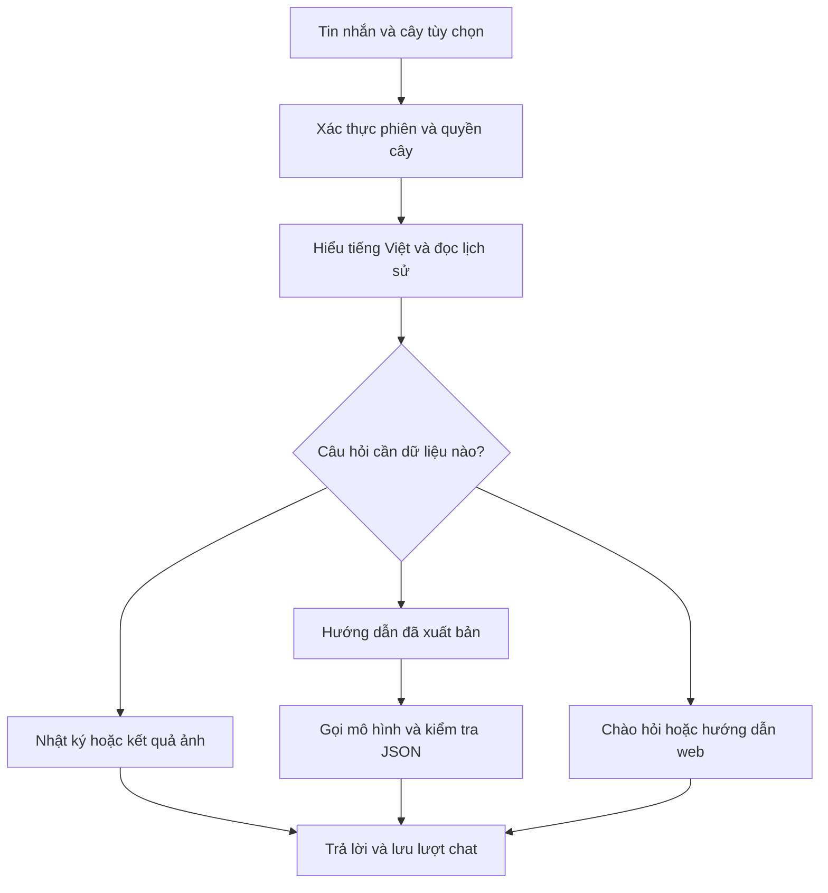
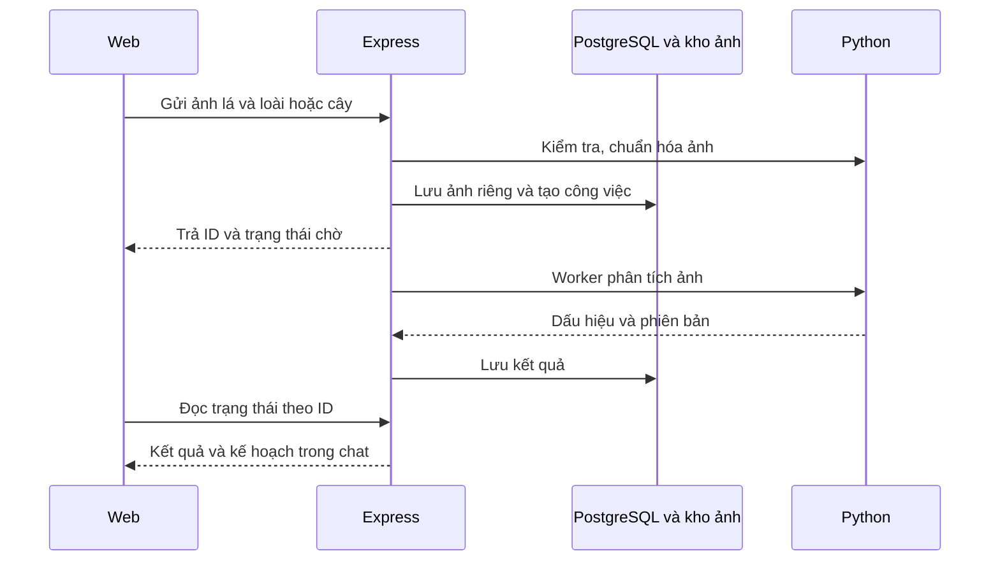

# Pipeline PlantCare AI: hội thoại, hồ sơ cây và ảnh lá

Bản web chính: [www.plantcare.io.vn](https://www.plantcare.io.vn/).

## Ý tưởng và phạm vi

Trợ lý kết hợp ba nguồn: câu hỏi tiếng Việt, dữ liệu của cây do người dùng đính kèm và hướng dẫn chăm sóc đã duyệt. Backend quyết định nguồn và kiểm tra quyền. Mô hình ngôn ngữ giúp hiểu cách diễn đạt và trình bày câu trả lời. Phần ảnh chạy bằng Python và trả dấu hiệu quan sát được. Chat đưa kết quả ảnh và việc nên làm theo ngày vào cùng hội thoại.

| Yêu cầu | Cách thực hiện |
| --- | --- |
| Không dấu, viết tắt, thiếu chữ | Giữ câu gốc trong lịch sử. Hiểu các cách nhập như `cchua la vagn`, `dualeo`, `ko`, `bn` và `ntn`. Mô hình dùng trường “Ý bạn là…?” khi còn khả năng hiểu nhầm. |
| Hội thoại tự nhiên | Đáp lời chào và cảm ơn, hỏi lại đúng điểm còn thiếu, nối các câu ngắn như “ở lá già” và “đất vẫn ướt” vào cây đang bàn. Khi nhắc loài khác, đổi ngữ cảnh. Trả lời các ý về trồng cây tại nhà hoặc cách dùng PlantCare và từ chối yêu cầu xa phạm vi. |
| Tin nhắn vô nghĩa hoặc mơ hồ | Với chuỗi ký tự, từ gõ ngẫu nhiên hoặc lời nhờ chưa nêu việc, chatbot đưa ví dụ để người dùng mô tả lại. Các dạng rõ ràng được xử lý trực tiếp ở backend. |
| Câu hỏi chăm cây | Có hướng dẫn sẵn cho tưới, đất, thay chậu, gieo hạt, phân bón, nắng, ra hoa, sâu hại, dấu hiệu trên lá và thu hoạch. Có thể trả lời nhiều ý chăm cây tách bằng dấu hỏi hoặc xuống dòng. |
| Hỏi về cây đã lưu | Khi đính kèm một cây đang theo dõi, chatbot đọc ngày trồng, các hoạt động gần nhất, ghi chú quan sát mới nhất và kết quả sàng lọc hoàn tất gần nhất của đúng cây. Câu trả lời nêu ngày của bằng chứng. Khi hỏi thời điểm ra quả, chatbot dùng loài, ngày trồng và giai đoạn người dùng hoặc nhật ký mô tả. Khi thiếu dữ liệu, chatbot hỏi về lá, nụ, hoa hoặc quả non. |
| Ảnh ngay trong chat | Tải ảnh theo cây đã chọn, nhận thẻ sàng lọc và kế hoạch theo ngày, chọn đúng ảnh để hỏi tiếp. |
| Dự đoán từng bệnh | Bản hiện tại khoanh vùng từ dấu hiệu hình ảnh. Chỉ bật xếp hạng bệnh sau khi có mô hình được kiểm định theo từng loài. |

## Luồng chatbot

1. Nút **+** trong ô chat cho phép chọn ảnh, loại cây hoặc cây trong Vườn cây. React xác nhận tên cây ngay sau khi chọn. Khi chỉ đính kèm cây rồi bấm Gửi, backend mở hồ sơ được phép truy cập và tóm tắt hoạt động gần nhất. POST /api/v1/chat nhận question, requestId và các trường tùy chọn plantId, speciesCode, diagnosisId hoặc contextDiagnosisId. Cookie và X-CSRF-Token bảo vệ thao tác ghi.
2. Express lấy accountId từ phiên. Mọi truy vấn cây, nhật ký và ảnh đều lọc theo quyền sở hữu. Cây đã lưu trữ hoặc thuộc tài khoản khác bị từ chối. Nếu người dùng vừa chọn cây vừa đính kèm ảnh, ảnh phải thuộc chính cây đó.
3. Backend chuẩn hóa câu, đọc tối đa sáu lượt gần nhất và lọc theo cây đang đính kèm. Khi người dùng đổi loài, ngữ cảnh cũ dừng ở ranh giới đó. Lượt hỏi tiếp có thể dùng tối đa hai mô tả gần nhất của cùng chủ đề cho hướng dẫn dự phòng. Lịch sử tưới dùng SQL và giờ Việt Nam. Kế hoạch theo ngày của ảnh dùng kết quả đã có.
4. Với câu hỏi cần diễn giải, backend lấy các hướng dẫn liên quan. Nếu cấu hình mô hình, backend gửi câu hỏi, lịch sử đã lọc, hướng dẫn và dữ liệu cần thiết của cây hoặc kết quả ảnh. Dữ liệu hồ sơ riêng như biệt danh, ghi chú tự do và email không được nạp tự động. Nội dung người dùng tự gõ có thể được gửi để trả lời. Ảnh gốc được xử lý trong dịch vụ ảnh.
5. Backend từ chối các yêu cầu ngoài phạm vi nhận diện rõ và kiểm tra trường `inScope` khi dùng mô hình. Đầu ra phải đúng JSON và nguồn chỉ gắn theo ID đã cấp. Khi thiếu thông tin hoặc mô hình gián đoạn, trả hướng dẫn phù hợp hoặc hỏi một chi tiết để tiếp tục. Cùng requestId và cùng dữ liệu trả lại lượt đã lưu.

## Luồng phân tích ảnh và kế hoạch chăm sóc

- POST /api/v1/diagnoses tiếp nhận JPEG, PNG hoặc WebP theo giới hạn kích thước, loài và quyền sở hữu. Idempotency-Key chống tạo lại cùng lượt. Python chuẩn hóa JPEG và loại metadata, sau đó backend ghi ảnh vào bucket riêng.
- PostgreSQL giữ lượt kiểm tra và hàng đợi. Worker nhận công việc bằng lease, gọi Python và lưu kết quả. Giao diện cập nhật thẻ thông qua GET /api/v1/chat/screening/{id}. Các trạng thái là queued, processing, completed và failed. Với lỗi tạm thời đủ điều kiện, người dùng có thể thử lại lượt cũ.
- Bộ sàng lọc hiện tìm vùng vàng và đốm sẫm bằng quy tắc màu. Kết quả gồm dấu hiệu quan sát được, khả năng để đối chiếu và việc nên làm hôm nay, ngày mai, sau 48–72 giờ. Trường hợp ảnh thiếu thông tin được hướng dẫn chụp lại. Nút Hỏi về ảnh này gửi contextDiagnosisId ở lượt tiếp theo.
- Để nâng từ sàng lọc lên xếp hạng bệnh: chọn một hoặc hai loài thí điểm, thu bộ ảnh gán nhãn đại diện cho cây khỏe, bệnh mục tiêu và nguyên nhân dễ nhầm, chia tập theo cây hoặc đợt chụp. Đánh giá top-1, top-3, độ nhạy theo lớp và tỷ lệ xin chụp lại. Chỉ hiển thị tối đa ba ứng viên qua ngưỡng đã kiểm định, xác suất chỉ dùng khi đã hiệu chuẩn. Gắn mỗi ứng viên với hướng dẫn đã duyệt và lưu phiên bản mô hình để truy vết. Đây là bước tiếp theo, chưa có mô hình xếp hạng bệnh trong bản hiện tại.

## Database và quyền

| Thành phần | Dữ liệu và quan hệ |
| --- | --- |
| accounts, sessions | Tài khoản, quyền User/Admin, mật khẩu Argon2id, phiên và dấu thời gian xác minh email. |
| account_email_challenges | OTP đăng ký hoặc đổi email. Mỗi bản ghi ràng buộc mục đích, email nhận và tài khoản đối với đổi email. Lưu HMAC, hạn dùng, hạn gửi lại và số lần thử. |
| plant_species, user_plants, care_logs | Danh mục loài, hồ sơ cây theo chủ tài khoản và lịch sử chăm sóc. |
| chat_turns | Mỗi lượt theo tài khoản, requestId, dấu vân tay yêu cầu, câu hỏi và câu trả lời JSON, plant_id và diagnosis_id tùy chọn. |
| images, diagnoses, diagnosis_jobs | Metadata tệp riêng, lượt sàng lọc theo tài khoản và cây, kết quả, phiên bản, trạng thái và công việc chờ. |
| diseases, disease_guides | Danh mục bệnh, hướng dẫn theo loài và phiên bản; chỉ đọc nội dung đã xuất bản vào chat. |

Migration 0012 bổ sung lịch sử chat và xác minh email đã đăng nhập. Migration 0013 thêm thử thách OTP trước đăng ký/đổi email và liên kết cây với lượt chat. Ảnh nằm ở S3/R2 hoặc MinIO, database giữ khóa đối tượng. API trả ảnh qua endpoint được bảo vệ theo quyền.

## Xác thực email

- Đăng ký gọi POST /api/v1/auth/register/send với email. Sau khi nhận OTP, gửi mã, challengeId và dữ liệu đăng ký đến POST /api/v1/auth/register. Chỉ tạo tài khoản và hồ sơ khi mã đúng. Trước đó, email chưa có tài khoản để đăng nhập.
- Đổi email gửi mã đến **địa chỉ mới** qua POST /api/v1/profile/credentials/email/send bằng phiên, CSRF và mật khẩu hiện tại. PATCH /api/v1/profile/credentials chỉ đổi email khi mã đúng. Sau khi lưu, các phiên cũ bị thu hồi. Đổi riêng mật khẩu tiếp tục dùng mật khẩu hiện tại.
- Mã sáu chữ số dùng một lần, hết hạn sau 10 phút, tối đa năm lần thử và gửi lại sau ít nhất 60 giây. Dùng Resend hoặc Gmail theo cấu hình đang hoạt động. Tài khoản đã tồn tại trước migration vẫn đăng nhập như trước và có thể xác minh email trong Hồ sơ.

## Triển khai và nghiệm thu

- Trên Render, giữ nhà cung cấp OTP đã gửi thành công, đặt APP_ORIGIN=https://www.plantcare.io.vn và chạy migration đến 0013. Deploy frontend Vercel sau khi backend sẵn sàng. Xem [cấu hình AI và OTP](nang-cap-chat-otp.md).
- Kiểm tra tài khoản mới chưa nhập mã không đăng nhập được, OTP sai/hết hạn/dùng lại, gửi lại và đổi email đúng mã. Đảm bảo email cũ giữ nguyên khi xác minh thất bại.
- Thử hai tài khoản. Tài khoản A đính kèm cây, hỏi lần tưới, gửi ảnh và hỏi kế hoạch ngày mai. Tài khoản B không đọc được cây, lượt ảnh hoặc nhật ký của A.
- Chạy smoke test trên Compose. Các test dùng mã giả ký bằng khóa local cho địa chỉ example.test; kiểm tra gửi thư thật riêng trên staging qua nhà cung cấp.
