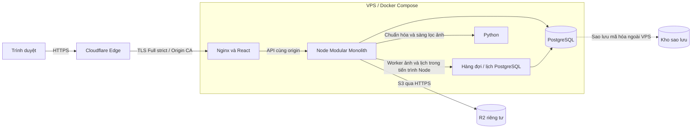

# Triển khai và vận hành

**Bản 0.5, ngày 19/11/2026.** Docker Compose local đã chạy với PostgreSQL và MinIO riêng tư. Bộ cấu hình VPS/R2 đã được chuẩn bị; chưa có môi trường online, tên miền hay chứng chỉ thật để nghiệm thu.

## Các file cần dùng

| Phần | File |
| --- | --- |
| Chạy và thử trên máy phát triển | [compose.yaml](../../compose.yaml), [hướng dẫn local](../../README.md#chạy-bản-local) |
| VPS với R2, HTTPS và cookie Secure | [compose.production.yaml](../../compose.production.yaml) |
| Domain, endpoint/bucket và image | [production.env.example](../../deploy/production.env.example), sao chép thành `.env.production` ngoài Git |
| Tạo bí mật lần đầu | [prepare-production.sh](../../scripts/prepare-production.sh) |
| Kiểm tra cấu hình, sao lưu, migration và khởi động | [deploy-production.sh](../../scripts/deploy-production.sh) |
| Build, kiểm thử và publish GHCR | [containers.yml](../../.github/workflows/containers.yml) |
| Thao tác VPS, cấp Admin, khôi phục và nghiệm thu | [Runbook triển khai](../../deploy/README.md) |

## Luồng chạy production

Production chỉ công khai cổng 443 của Nginx. Backend, Python và PostgreSQL dùng mạng Compose; backend có đường ra R2. Nginx chuyển HTTP nội bộ tới API và ghi lại các header proxy, không chuyển nguyên header do client gửi. `trust proxy = 1` tại Express áp dụng cho hop Nginx ngay trước API. Giới hạn firewall tại VPS vẫn phải cấu hình theo runbook.

`/health/live` kiểm tra tiến trình HTTP, `/health/ready` kiểm tra các bảng cần thiết. Python có healthcheck riêng. Ảnh cần R2 hoạt động để tải/lưu; readiness hiện không kiểm tra quyền truy cập bucket, nên phải kiểm tra upload/download bằng tài khoản thử sau triển khai.

Worker chẩn đoán và lịch chạy trong Node backend hiện tại. Job, lease, lịch và thông báo lưu trong PostgreSQL để tiếp tục sau khởi động lại. Lịch dùng UTC+7, không phát SMS, email hay Web Push. Không cần VAPID hoặc push subscription ở bản này.

## Giới hạn và bước nghiệm thu

- Compose đặt giới hạn tài nguyên, pool DB và xoay log. API upload có giới hạn dung lượng và đồng thời, đăng nhập có giới hạn thử, truy vấn danh sách có phân trang. Cần đo tải staging để xác định khả năng phục vụ; chưa có kết quả tải cao để cam kết số người dùng.
- Workflow đã chuẩn bị kiểm tra trước publish; chưa chạy trên repository GitHub thật. Triển khai VPS là bước riêng bằng script, chưa có SSH tự động hoặc thông tin truy cập VPS.
- Cần domain, VPS, R2 và Origin CA để nghiệm thu HTTPS, upload ảnh, khởi động lại, sao lưu/khôi phục và cảnh báo vận hành. Hệ thống chạy trên VPS giảm phụ thuộc máy cá nhân, không bảo đảm tránh mọi sự cố mất điện hoặc gián đoạn hạ tầng.
- Swagger dùng dữ liệu giả trên local/staging; production tắt đường công khai. Bí mật, ảnh riêng và bản sao lưu không được đưa vào tài liệu, log hoặc repository.

Tham khảo cấu hình nhà cung cấp tại [Cloudflare Full strict](https://developers.cloudflare.com/ssl/origin-configuration/ssl-modes/full-strict/), [R2 S3 API](https://developers.cloudflare.com/r2/api/s3/api/) và [Docker Compose secrets](https://docs.docker.com/compose/how-tos/use-secrets/).
