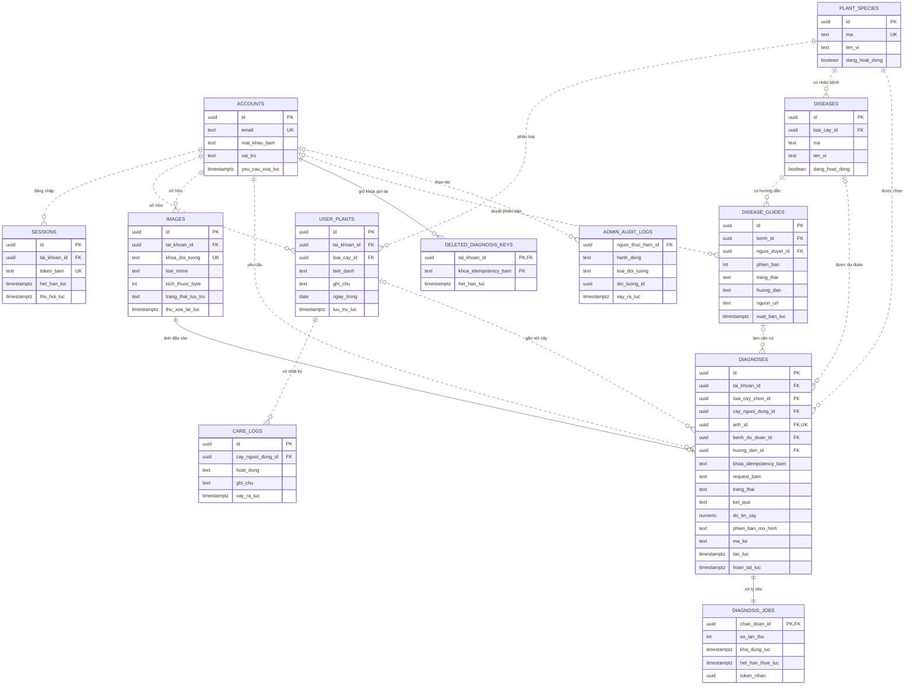
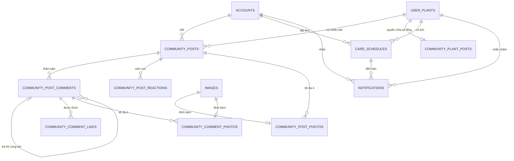

# Cấu trúc dữ liệu PlantCare AI · 0.5

PostgreSQL giữ tài khoản, danh mục, nhật ký, chẩn đoán và công việc nền. R2 giữ ảnh đã xử lý trong bucket riêng tư. Môi trường local dùng MinIO. Tên cột trong sơ đồ là tên dùng khi tạo schema. Hợp đồng JSON dùng tên camelCase.

[Ràng buộc SQL](rang-buoc.md) · [Vòng đời dữ liệu](vong-doi-du-lieu.md) · [Hợp đồng API](../03-kien-truc/api.md)

[Ảnh sơ đồ bản 0.5](../07-so-do/README.md) được dựng ngày 19/11/2026 từ metadata PostgreSQL đã áp dụng `0001`–`0011`: 24 bảng nghiệp vụ và `schema_migrations`. Có ERD tổng, cộng đồng và lịch/thông báo. Kết quả kiểm thử ghi ở [trạng thái](../02-phat-trien/trang-thai.md). [Bản nháp thiết kế cũ](du-thao/README.md) chỉ để tham khảo lịch sử.

Các migration bổ sung sau ERD v2 gồm [0002](../../backend/migrations/0002_community.sql) cho cộng đồng, [0003](../../backend/migrations/0003_symptom_screening.sql) cho kết quả sàng lọc, [0004](../../backend/migrations/0004_home_crops.sql) cho ba loài cây và [0005](../../backend/migrations/0005_journal_photos.sql) cho nhật ký ảnh. [0006](../../backend/migrations/0006_journal_gallery.sql) chuyển ảnh cũ từ `care_logs.anh_id` sang `care_log_photos`. Khóa ngoại ghép giữ ghi chú và từng ảnh cùng chủ, vị trí từ 0 đến 3 xác định thứ tự.

[0007](../../backend/migrations/0007_community_history.sql) thêm tùy chọn chia sẻ lịch sử vào bài của cây. Lịch sử cộng đồng đọc trạng thái mới nhất từ cây, ghi chú và các lần sàng lọc đã gắn qua `diagnoses.cay_nguoi_dung_id`. [0008](../../backend/migrations/0008_profile.sql) thêm `account_profiles`, mỗi tài khoản có tối đa một hồ sơ và một ảnh đại diện cùng chủ. Bucket vẫn giữ ảnh riêng tư.

| Migration 0.5 | Thay đổi |
| --- | --- |
| [0009 · Cộng đồng nhiều bài](../../backend/migrations/0009_community_posts.sql) | Sáu bảng: `community_posts`, `community_post_comments`, `community_post_reactions`, `community_comment_likes`, `community_post_photos`, `community_comment_photos`. Chuyển bài/bình luận cũ, giữ quyền tổng ở `community_plant_posts`. |
| [0010 · Quản trị](../../backend/migrations/0010_admin.sql) | Mở rộng CHECK audit cho khóa/mở tài khoản, cấp Admin và ẩn/hiện bài; thêm chỉ mục thời gian. Không tạo mật khẩu hoặc Admin mặc định. |
| [0011 · Lịch và thông báo](../../backend/migrations/0011_schedules.sql) | `care_schedules` và `notifications`, khóa ngoại ghép cùng chủ, chống trùng nhập local và nhắc lịch, chỉ mục đến hạn/chưa đọc. |

## Sơ đồ nền tảng ERD v2 rút gọn

## Ràng buộc nghiệp vụ

| Nhóm | Quy tắc |
| --- | --- |
| Tài khoản | Email chuẩn hóa và duy nhất. Mật khẩu băm Argon2id. `vai_tro` có hai giá trị `user` và `admin`, mặc định `user`. Admin được cấp qua quy trình vận hành. Lưu bản băm token phiên. |
| Cây và nhật ký | Lấy `tai_khoan_id` từ phiên. Tra nhật ký qua cây thuộc chủ sở hữu. Loài của cây giữ cố định từ lúc tạo. Khi ngừng theo dõi, lưu thời điểm lưu trữ để giữ lịch sử. |
| Ảnh và chẩn đoán | `anh_id`, `tai_khoan_id` và `loai_cay_chon_id` bắt buộc. `UNIQUE (anh_id)` giữ mỗi ảnh thuộc tối đa một chẩn đoán. Khóa ngoại ghép kiểm tra ảnh cùng chủ. Khi có `cay_nguoi_dung_id`, khóa ngoại ba cột kiểm tra cây cùng chủ và đúng loài. Chẩn đoán riêng để trống `cay_nguoi_dung_id`. |
| Danh mục và hướng dẫn | Mã bệnh duy nhất theo loài. Số phiên bản duy nhất theo bệnh. Tối đa một hướng dẫn đang xuất bản cho mỗi bệnh. Khi xuất bản bản mới, chuyển bản đang dùng sang `retired` trong cùng giao dịch. Giữ bản đã xuất bản để truy lại lịch sử. |
| Kết quả | `completed` có kết quả, điểm mô hình từ 0 đến 1 và phiên bản mô hình. Chỉ kết quả `disease` có bệnh dự đoán. Khóa ngoại ghép ràng buộc bệnh thuộc loài đã chọn và hướng dẫn thuộc đúng bệnh. `failed` có mã lỗi. `completed` và `failed` có thời điểm kết thúc. |
| Công việc nền | `chan_doan_id` vừa là khóa chính vừa là khóa ngoại. Tạo job cùng giao dịch với chẩn đoán và giữ job qua các trạng thái kết thúc để có thể thử lại trên cùng dòng. Worker chỉ nhận job đủ điều kiện theo trạng thái và thời điểm khả dụng. |
| Gửi lại | Khóa chống trùng duy nhất theo tài khoản. `request_bam` được tính từ ảnh đầu vào, `speciesCode` và `plantId`. Cùng khóa và nội dung trả cùng ID. Cùng khóa khác nội dung trả `409`. Khóa của chẩn đoán vừa xóa trả `410` trong 24 giờ. |
| Nhật ký quản trị | Ghi người thực hiện, hành động, loại và mã đối tượng, thời điểm. Cặp hành động và loại đối tượng theo danh sách cố định. `doi_tuong_id` có thể tham chiếu các danh mục khác nhau nên log vẫn tồn tại sau khi đối tượng bị xóa. Nếu xóa tài khoản Admin, đặt `nguoi_thuc_hien_id` về `NULL`. |
| Bài cộng đồng | Nhiều bài thuộc một cây và cùng chủ qua FK ghép; một cảm xúc mỗi tài khoản/bài. `an_luc` độc lập với quyền chia sẻ tổng và sự đồng ý lịch sử. |
| Bình luận và ảnh | Trả lời tham chiếu cùng bài qua `(parent_id,post_id)`; xóa cha xóa nhánh con. Thích duy nhất theo tài khoản/bình luận. Ảnh ghép đúng chủ, thứ tự 0–3; khi gỡ ảnh ghi `pending_delete`. |
| Lịch và thông báo | Lịch cùng chủ cây, UTC+7 cố định; `client_id` duy nhất theo tài khoản khi có. Thông báo duy nhất `(lich_id,hen_luc)`, FK ghép giữ lịch/cây/tài khoản cùng chủ. Không có bảng occurrence ở MVP này. |

`DIAGNOSIS_FEEDBACK` thuộc giai đoạn 2. Khi triển khai, giới hạn một phản hồi của chủ cho mỗi chẩn đoán. Việc dùng phản hồi làm nhãn huấn luyện cần kết quả thẩm định `chap_nhan` và quyền sử dụng dữ liệu tương ứng.

## Chỉ mục ban đầu

- Danh sách cây theo `(tai_khoan_id, luu_tru_luc)` và nhật ký theo `(cay_nguoi_dung_id, xay_ra_luc DESC, id DESC)`.
- Lịch sử nhận diện theo `(tai_khoan_id, tao_luc DESC, id DESC)` và `(cay_nguoi_dung_id, tao_luc DESC, id DESC)`.
- Phiên theo `tai_khoan_id` để thu hồi. Phiên và khóa gửi lại sau xóa theo `het_han_luc` để dọn hết hạn. Ảnh chờ xóa theo `thu_xoa_lai_luc` với điều kiện `trang_thai_luu_tru = 'pending_delete'`.
- Job theo `kha_dung_luc` và `het_han_thue_luc`. Chẩn đoán theo trạng thái để nhận việc và đếm sức chứa. Đo truy vấn với dữ liệu thử trước khi chốt chỉ mục migration.

## Quan hệ bổ sung trong 0.5

Sơ đồ trên rút gọn để đọc quan hệ. Danh sách đầy đủ cột, khóa ghép, CHECK, trigger và hành vi xóa nằm trong migration. Bài cũ chuyển sang `community_posts`, bình luận chuyển sang `community_post_comments`; bảng cũ còn hỗ trợ tương thích. `legacy_feed` phân biệt bài kế thừa với cây chỉ dùng làm quyền tổng cho bài mới. Trigger đồng bộ đường chia sẻ cũ và đánh dấu ảnh bị gỡ để dọn.

### Lịch đã triển khai

`care_schedules` lưu chủ/cây, `client_id`, hoạt động, tiêu đề, ngày bắt đầu, giờ hẹn, `mui_gio`, loại/khoảng lặp, trạng thái bật, `den_han_luc` và thời điểm xóa mềm. Múi giờ cố định `Asia/Ho_Chi_Minh`; loại lặp gồm once/daily/weekly/monthly, khoảng lặp 1–365. CHECK buộc lịch bật có thời điểm đến hạn, lịch đã xóa phải tắt. Unique `(tai_khoan_id,client_id)` chống trùng khi chuyển dữ liệu trình duyệt.

`notifications` lưu chủ/cây/lịch, thời điểm dự kiến, tiêu đề/nội dung và thời điểm tạo/đọc. Unique `(lich_id,hen_luc)` chống một lần nhắc bị tạo hai lần. Worker tạo thông báo và tiến lịch trong cùng giao dịch. Lưu trữ cây hoặc khóa tài khoản làm worker bỏ qua; không xóa lịch sử thông báo chỉ vì tạm dừng/xóa mềm lịch.

Bản này chưa tạo `care_occurrences`, `notification_preferences` hoặc `push_subscriptions`; chưa tự sinh care log khi đánh dấu thông báo đã đọc. Các bảng đó thuộc thiết kế mở rộng trước đây, không phải schema đang triển khai. [API thực tế](../03-kien-truc/api.md)

Migration 0012 thêm chat_turns (theo tài khoản, tham chiếu lượt sàng lọc có thể xóa), email_verification_codes (một mã HMAC đang theo dõi cho mỗi tài khoản) và accounts.email_xac_minh_luc.

Migration 0013 thêm account_email_challenges (OTP theo mục đích, email và tài khoản khi đổi địa chỉ) và chat_turns.plant_id tham chiếu user_plants; backend kiểm tra chủ sở hữu trước khi đọc ngữ cảnh.
